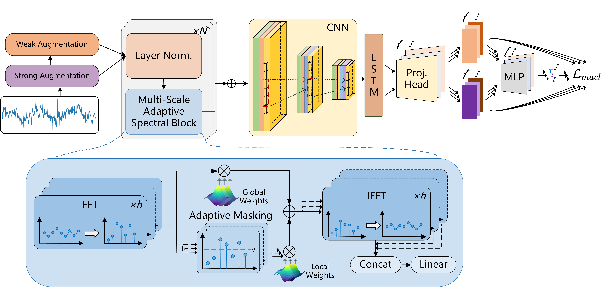

# DAMR: Dual Adaptive Multi-Head Representation Learning for Multivariate Time Series Anomaly Detection

*by: Yining Wang, Fujun Han, Ke Li, Shuhan Liu, Tao Chen, and Zhaohui Peng*

### 🎉 This paper has been accepted for publication at KDD 2026 (Second Cycle), with an overall acceptance rate of ~18.5% 🎉


## Abstract

Multivariate Time Series Anomaly Detection (MTSAD) has broad real-world applications, including vehicles, industrial plants, and monitoring systems. Most existing MTSAD approaches focus primarily on Transformer-based temporal modeling and representation learning, yet they still overlook two key limitations: sensitivity to noise perturbations and limited diversity in learned temporal representations. These issues hinder fine-grained discrimination between normal and anomalous samples. To address them, we introduce **DAMR**, a novel dual adaptive multi-head representation learning framework for MTSAD. Specifically, we design a feature extraction module based on the Multi-Scale Adaptive Spectral Block (MSASB) to capture multi-scale temporal patterns in both the time and frequency domains. We then employ multiple projection heads to generate diverse representations and capture variations induced by different data augmentations. Furthermore, to improve representational flexibility, we introduce an independent adaptive temperature for each projection head to reweight similarity scores between time-series pairs. Extensive experiments on five widely used datasets demonstrate that DAMR achieves significant performance gains and strong robustness to noise compared with existing competitive methods, including improvements of +5.7% on WADI and +4.7% on MSL. Notably, compared with Transformer-based temporal modeling approaches, DAMR requires substantially fewer FLOPs and less GPU memory. The code is available at https://github.com/wyn404/DAMR.



## Datasets

The datasets used in this work are publicly available and can be accessed through [TimesNet](https://github.com/thuml/Time-Series-Library).

## Citation

If you find this code helpful for your research, please cite our paper [DAMR: Dual Adaptive Multi-Head Representation Learning for Multivariate Time Series Anomaly Detection](https://dl.acm.org/doi/10.1145/3770855.3817943).


```bibtex
@inproceedings{wang2026damr,
  title={DAMR: Dual Adaptive Multi-Head Representation Learning for Multivariate Time Series Anomaly Detection},
  author={Wang, Yining and Han, Fujun and Li, Ke and Liu, Shuhan and Chen, Tao and Peng, Zhaohui},
  booktitle={Proceedings of the 32nd ACM SIGKDD Conference on Knowledge Discovery and Data Mining V. 2},
  pages={5137--5147},
  year={2026}
}
```
## Quick Start

Taking the MSL dataset as an example:

1. Download the datasets to `./data`.
2. Run the following script:
   ```bash
   bash run/run_MSL.sh 0
   ```

## Acknowledgements

The components of our framework are inspired by the following works:

- [TSLANet](https://github.com/emadeldeen24/TSLANet/)
- [AMCL](https://github.com/LeiWangR/cl)
- [MSAD](https://github.com/talreiss/Mean-Shifted-Anomaly-Detection)
